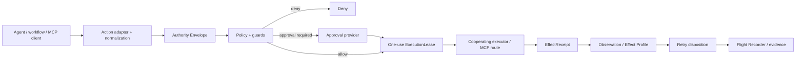

# RuleOak architecture overview

RuleOak is a protocol-neutral, application-layer action-control and effect-evidence system. Its central design rule is that **authorization and outcome are separate authorities**.

## System view

RuleOak does not plan tasks, choose models, provide general RAG/memory, or originate business actions. It governs and records actions that deliberately cross its boundary.

## 1. Action normalization

Adapters convert transport- or framework-specific calls into a stable action/resource representation. Authorization is performed against that normalized identity rather than an opaque prompt or display label.

A tool name alone is not trusted effect semantics.

## 2. Authority and policy

The authority layer expresses bounded principal/delegation constraints. Policy evaluates the exact normalized action and can return allow, deny or approval-required. Revocation and stale-state checks are part of the same authority lifecycle.

## 3. Approval

Approval adds explicit authorization when policy requires it. An approval is not treated as unlimited reusable permission. The execution path still receives short-lived one-use authority bound to the reviewed action.

## 4. One-use execution

`ExecutionLease` narrows the time-of-check/time-of-use gap and rejects simple replay. A cooperating executor consumes the lease before causing the guarded side effect.

RuleOak cannot enforce one-use semantics on a side channel that bypasses the cooperating executor.

## 5. Effect receipt

Execution produces an `EffectReceipt` describing what RuleOak observed and how the operation was identified. This is evidence, not automatically proof of the intended external-world postcondition.

## 6. Effect verification

An `Effect Profile` defines trusted postcondition semantics for a specific operation/resource shape. Verification may inspect filesystem state, external identifiers or another bounded observable postcondition.

If trusted semantics are absent, the effect remains unresolved rather than inferred from a generic tool name, process return code or HTTP status.

## 7. Retry disposition

RuleOak distinguishes three broad outcomes:

- confirmed success → do not retry;
- confirmed no-effect plus duplicate-safe semantics → retry may be considered, but with fresh authority;
- unresolved/ambiguous effect → verify before retry.

The consumed lease is never silently reused.

## 8. Evidence

Flight Recorder records redacted local evidence and supports chain verification, graph navigation and offline reports. Hash chaining makes event-sequence modification detectable when the expected chain is retained; it does not make local storage immutable against a privileged host actor.

## Integration boundaries

### Node.js SDK

Strongest when the application owns the tool registry and can ensure consequential functions are invoked only through guarded wrappers.

### MCP stdio / Streamable HTTP

Useful when the client/server route can be explicitly interposed. RuleOak does not claim control over built-in tools or alternate connections that bypass the managed route.

### REST authorization

Useful for other local runtimes. Loopback is the safe default. Non-loopback deployments require explicit transport authentication/security and should be reviewed as a separate deployment boundary.

## Reliability surfaces

Inspector, Capability Watch and CrashLab support the boundary without replacing it:

- Inspector discovers and fingerprints capabilities;
- Capability Watch tracks normalized drift;
- CrashLab exercises failure, retry, concurrency and stale-state contracts.

Discovery metadata never grants execution authority.

## Development verification

The repository also includes experimental source-candidate verification workflows. They are deliberately separated from runtime effect authority: a coding model may propose source changes, but it does not certify its own correctness.

## Security posture

See [Security boundary](../security-boundary.md) and [Threat model](../threat-model.md) for deployment assumptions, threats and non-goals.
