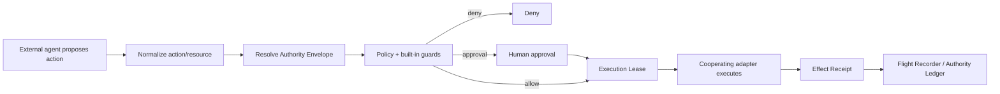

# RuleOak Architecture Overview

RuleOak is **Flight Control for AI Agents**: a protocol-neutral agent action control plane.

RuleOak does not plan tasks, choose models, provide RAG/memory, or originate business actions.
